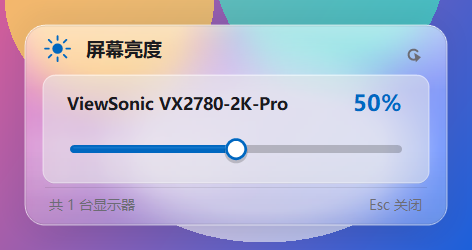
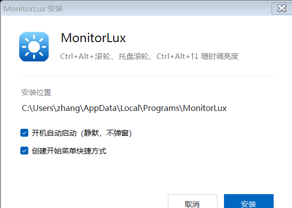

# MonitorLux

**用鼠标滚轮调外接显示器亮度 —— 不弹窗口，不要管理员权限，不占地方。**

[](#兼容性)
[](#从源码构建)
[](LICENSE)

[English](README.md) · 简体中文


---

## 为什么做这个

如果你在 **NVIDIA 显卡 + DisplayPort 外接屏** 的笔记本上装过 **Twinkle Tray** 或 **Monitorian**，大概率遇到过滑块是灰的、拖了没反应。真正的原因不是显示器不支持：

Windows 通过 `dxva2.dll` 的 `GetMonitorCapabilities()` 让软件查询"这台显示器能不能调亮度"。在某些 NVIDIA 驱动 + DP 的组合下这个接口会**误报**，返回的能力位是 `0x0` —— 等于告诉软件"这块屏不支持调亮度"。

大部分亮度工具信了这个答案，把滑块置灰，然后放弃。

但显示器其实是能被控制的，写入操作完全正常，**错的只是那份能力报告**。

**本程序完全跳过能力检测，直接对 DDC/CI 发包**（`GetMonitorBrightness` / `SetMonitorBrightness`）。在那些软件失效的同一台机器上，它是通的。

```
> MonitorLux.exe --selftest
Monitor=[ViewSonic VX2780-2K-Pro] Ok=True cur=50 max=100
```

## 特性

| | |
|---|---|
| 🖱️ **任意位置滚滚轮** | `Ctrl + Alt + 滚轮`，在哪个窗口都能调，不用点开任何东西 |
| ⌨️ **全局热键** | `Ctrl + Alt + ↑ / ↓`，每次 ±5% |
| 🖼️ **磨砂玻璃 OSD** | 右下角淡入一个小胶囊显示百分比，随后自动消失。点击穿透，不抢焦点 |
| 🪟 **纯托盘** | 没有主窗口。需要看详情时才弹面板 |
| 🌗 **深浅色跟随系统** | 每次弹出时实时读取系统主题，切主题不用重启 |
| 🔓 **不需要管理员权限** | 普通用户即可写 DDC/CI，所以每次开机不会弹 UAC |
| 🚀 **单实例** | 重复启动会自动静默退出 |
| 📦 **绿色单文件** | 一个 exe，不装运行时；除了可选的自启项不碰注册表 |

## 安装

**方式一：安装包（推荐）**

到 [Releases](../../releases) 下载 `Setup.exe` 运行。会装到 `%LOCALAPPDATA%\Programs\MonitorLux`，建开始菜单和桌面快捷方式，开启开机自启并直接启动。卸载走 **设置 → 应用**。

**方式二：绿色版**

下载 `MonitorLux.exe` 直接运行，托盘出现图标即完成。想让它开机自动起来：右键托盘图标 → 勾选「开机自启」。

装完之后就不需要再"打开"它了。

## 使用

| 操作 | 效果 |
|---|---|
| `Ctrl + Alt` + **滚轮** | 在任意位置调节亮度 |
| `Ctrl + Alt + ↑` / `↓` | 每次 ±5% |
| 在**托盘图标**上滚轮 | 不用按修饰键也能调 |
| **左键**点托盘图标 | 打开完整面板（所有显示器 + 滑块） |
| **Esc** / 点面板外 | 收起面板 |
| **右键**托盘图标 | 刷新显示器 · 开机自启 · 退出 |





## 命令行

适合写脚本、做快捷方式或绑到 Stream Deck 上。**不依赖托盘进程，单独跑也行。**

```bat
MonitorLux.exe --set 20          :: 设为 20%
MonitorLux.exe --step -5         :: 减 5%
MonitorLux.exe --step +10        :: 加 10%
MonitorLux.exe --selftest        :: 列出显示器并打印当前亮度
MonitorLux.exe --autostart-on    :: 开启开机自启
MonitorLux.exe --uninstall       :: 清除自启与注册表项
```

## 实现要点

- **亮度**走 `dxva2.dll`（`GetNumberOfPhysicalMonitorsFromHMONITOR` → `SetMonitorBrightness`），刻意**跳过** DDC/CI 的能力查询。写入做了防抖 —— 连续两条 DDC 命令间隔太近会被显示器丢弃；写入失败会自动重试一次。
- **OSD**：先把自身位置背后的桌面抓下来，降采样 → 模糊 → 升采样，再叠一层染色、顶部高光和 1px 内描边画进圆角胶囊。WinForms 一旦给内容画半透明，DWM 的丙烯酸模糊层就会被吃掉，所以玻璃是手工渲染的。
- **滚轮**用底层钩子（`WH_MOUSE_LL`）捕获；托盘图标的屏幕矩形做了缓存，钩子不会为每个滚轮事件都去问 shell。
- **DPI 感知**：清单声明 `PerMonitorV2`，在缩放屏上按原生像素渲染，而不是被系统位图拉伸。
- **图标**是程序化生成的：一张 ico 里 16~256px 共九个尺寸，小尺寸单独调几何，不是把大图缩小。

## 从源码构建

不需要 SDK、不需要 NuGet、不需要 Visual Studio —— 只要 Windows 自带的 PowerShell 5.1 和 .NET Framework。

```powershell
git clone https://github.com/ilikereadbook/MonitorLux.git
cd MonitorLux

# 主程序 -> dist\MonitorLux.exe
powershell -ExecutionPolicy Bypass -File .\build\build.ps1

# 单文件安装器 -> dist\Setup.exe
powershell -ExecutionPolicy Bypass -File .\build\build-setup.ps1

# 重新生成 assets\app.ico 与 docs\icon.png
powershell -ExecutionPolicy Bypass -File .\build\make-icon.ps1
```

```
src/       MonitorLux.cs（主程序） · Setup.cs（安装器） · app.manifest
build/     build.ps1 · build-setup.ps1 · make-icon.ps1
assets/    app.ico
docs/      截图
```

## 兼容性

- **Windows 11**（在 build 26200 上实测）和 **Windows 10**
- 显示器需在 OSD 菜单里**开启 DDC/CI**，多数默认开启
- **DP / HDMI / DVI / VGA** 都行，前提是线材传了 DDC 通道
- **笔记本内置屏**一般没有 DDC/CI，请用系统自带的亮度滑块
- 不是每台显示器都提供亮度 VCP 码 —— `--selftest` 报 `Ok=False` 说明这块屏确实不接受 DDC 写入

**已知限制**

- KVM、HDMI 切换器、部分 USB-C 扩展坞会吃掉 DDC 信号，请直连显示器
- HDR 模式下部分面板的主亮度控制会表现异常
- 目前只用亮度 VCP 码（0x10），对比度、输入源等尚未支持

## 常见问题

**它一定要在后台跑吗？**
要 —— 总得有人监听滚轮和热键。但它随 Windows 静默启动，实际体验是装一次之后再也想不起来它。

**会不会和 Twinkle Tray 冲突？**
两者都挂全局钩子、都写同一个 VCP 码，二选一。

**按热键没反应？**
先确认托盘里有图标。如果有，可能是别的程序已经占了 `Ctrl+Alt+↑/↓` —— 这两个热键是全局的，先到先得。

## 许可

[MIT](LICENSE)
